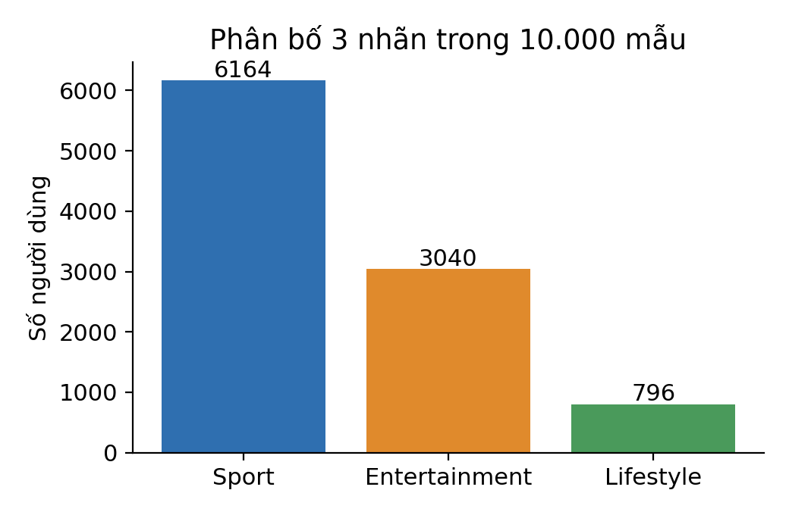
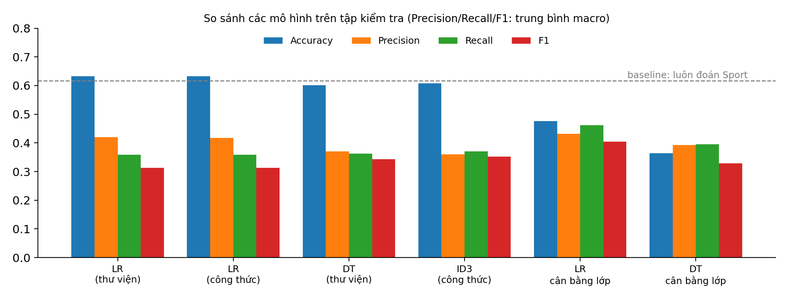
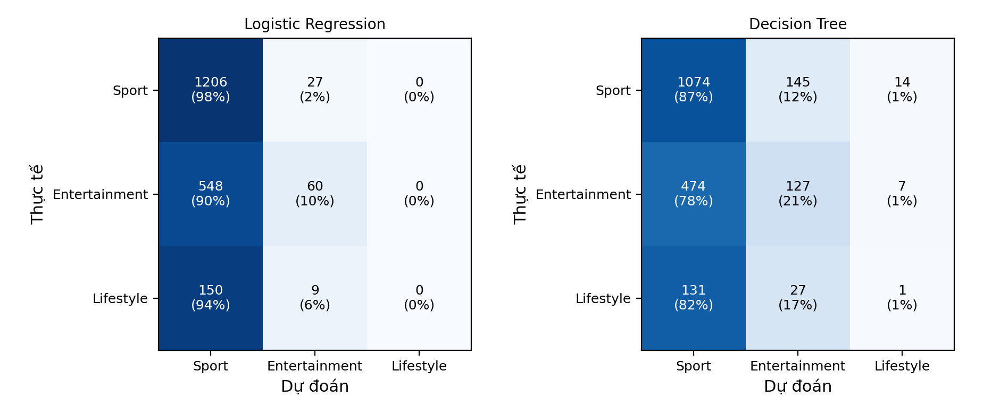
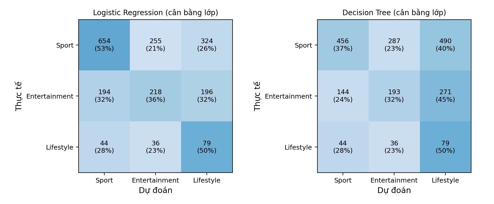
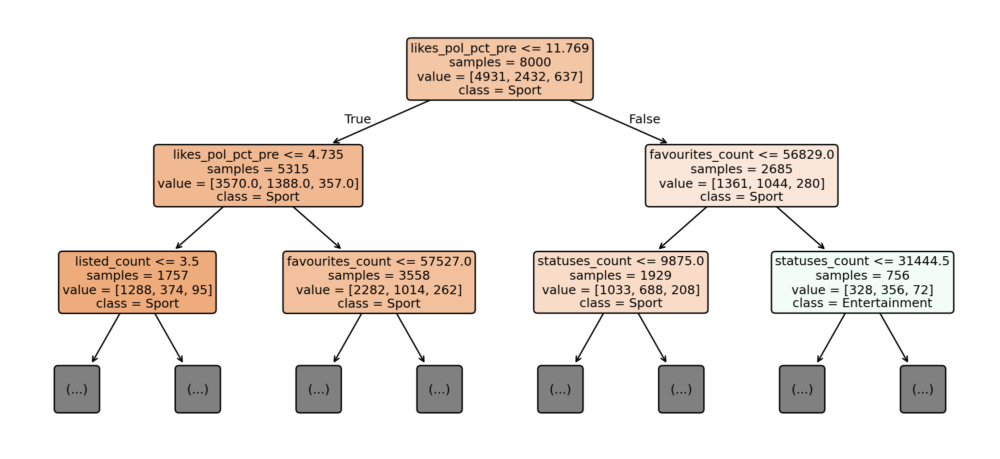
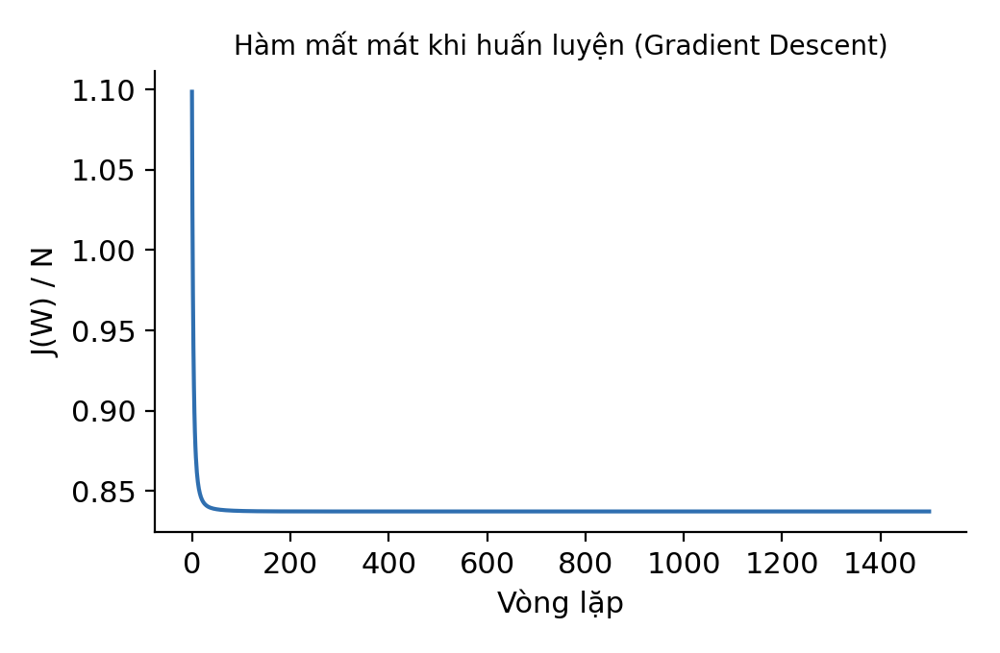

# Báo cáo kết quả thực nghiệm phân loại chủ đề quan tâm

## 1. Mục tiêu và dữ liệu

Thực nghiệm dự đoán một trong ba chủ đề quan tâm của người dùng Twitter: **Sport**, **Entertainment** và **Lifestyle**. Dữ liệu được ghép từ bộ Dryad `10.5061/dryad.7sqv9s50w`.

Bảng thông tin tài khoản `UserInfo.csv` có **45.509** người dùng, nhưng chỉ **21.980** người có nhãn chủ đề trong `Final_topic_classification.csv`; những người còn lại không có nhãn nên không dùng để huấn luyện và đánh giá. Ba file được ghép theo mã người dùng (`UserIDs`); riêng `UserAnalysis_Data.csv` lưu mã người dùng dưới dạng số thực nên khóa ghép được chuyển sang kiểu `float64`. Sau khi ghép có **21.980** bản ghi; loại các bản ghi thiếu một trong bốn biến hành vi dùng làm đặc trưng thì còn **20.768** bản ghi đầy đủ. Từ đó, lấy mẫu phân tầng cố định **10.000** người dùng (seed = 42), giữ tỷ lệ nhãn:

| Nhãn | Số mẫu | Tỷ lệ |
|---|---:|---:|
| Sport | 6.164 | 61,64% |
| Entertainment | 3.040 | 30,40% |
| Lifestyle | 796 | 7,96% |
| **Tổng** | **10.000** | **100%** |

Sử dụng **10 đặc trưng**:

1. `account_age_days`
2. `listed_count`
3. `favourites_count`
4. `statuses_count`
5. `friends_count`
6. `followers_count`
7. `tweets_media_pct_pre`
8. `likes_media_pct_pre`
9. `tweets_pol_pct_pre`
10. `likes_pol_pct_pre`

## 2. Chia dữ liệu

Chia phân tầng theo nhãn với tỷ lệ 80/20 và seed = 42:

| Tập | Số mẫu | Sport | Entertainment | Lifestyle |
|---|---:|---:|---:|---:|
| Huấn luyện | 8.000 | 4.931 | 2.432 | 637 |
| Kiểm tra | 2.000 | 1.233 | 608 | 159 |

Các độ sâu cây được chọn bằng **Stratified 5-fold cross-validation trên tập huấn luyện**. Tập kiểm tra không được dùng để huấn luyện hay chọn độ sâu cây; tập này chỉ dùng để đánh giá và so sánh các mô hình.

## 3. Kết quả đánh giá trên tập kiểm tra

Các chỉ số dưới đây được tính trên tập kiểm tra (2.000 mẫu); Precision, Recall và F1 là trung bình macro trên ba lớp.

| Mô hình | Accuracy | Macro Precision | Macro Recall | Macro F1 |
|---|---:|---:|---:|---:|
| Baseline — luôn đoán Sport | 0,6165 | 0,2055 | 0,3333 | 0,2543 |
| Logistic Regression (thư viện) | 0,6330 | 0,4195 | 0,3589 | 0,3131 |
| Logistic Regression (công thức softmax) | 0,6325 | 0,4173 | 0,3587 | 0,3129 |
| Decision Tree (thư viện) | 0,6010 | 0,3700 | 0,3621 | 0,3429 |
| Decision Tree ID3 (công thức) | 0,6075 | 0,3604 | 0,3704 | 0,3517 |
| **Logistic Regression (cân bằng lớp)** | **0,4755** | **0,4311** | **0,4619** | **0,4048** |
| Decision Tree (cân bằng lớp) | 0,3640 | 0,3921 | 0,3947 | 0,3292 |

## 4. Chọn mô hình và nhận xét

Chọn **Logistic Regression cân bằng lớp** nếu mục tiêu là cân bằng hiệu quả giữa ba chủ đề: mô hình này có **Macro F1 cao nhất (0,4048)**, đồng thời Macro Precision = 0,4311 và Macro Recall = 0,4619 cũng cao nhất trong các mô hình đã thử.

Mô hình Logistic Regression không cân bằng có Accuracy cao nhất trong các mô hình học được (0,6330), nhưng Macro F1 chỉ đạt 0,3131. Điều này cho thấy Accuracy bị ảnh hưởng mạnh bởi lớp Sport chiếm 61,64% mẫu. Ở kết quả theo lớp, mô hình không cân bằng không dự đoán được lớp Lifestyle; Logistic Regression cân bằng lớp đạt Recall Lifestyle 0,4969 nhưng Precision Lifestyle chỉ 0,1319. Vì vậy, kết quả cân bằng lớp cải thiện khả năng nhận diện lớp thiểu số, nhưng còn nhiều dự đoán Lifestyle sai.

Baseline luôn đoán Sport đạt Accuracy 0,6165 nhưng Macro F1 chỉ 0,2543 và không nhận diện được hai lớp còn lại. Không nên dùng Accuracy đơn lẻ để kết luận mô hình phù hợp cho dữ liệu lệch lớp.

## 5. Đánh giá chéo chọn độ sâu cây

Macro F1 trung bình qua 5 fold trên tập huấn luyện:

| Độ sâu | Cây entropy (thư viện) | ID3 (công thức) |
|---:|---:|---:|
| 2 | 0,2852 | 0,2829 |
| 3 | 0,3117 | 0,2991 |
| 4 | 0,3261 | 0,3347 |
| 5 | 0,3250 | **0,3379** |
| 6 | 0,3298 | — |
| 8 | **0,3474** | — |

Độ sâu được chọn là **8** cho cây entropy trong thư viện và **5** cho ID3 tự cài đặt.

## 6. Biểu đồ và tệp kết quả

Các hình bên dưới được tạo từ lần chạy trên 10.000 mẫu và lưu trong thư mục `out`.

### Phân bố nhãn

### So sánh chỉ số các mô hình

### Ma trận nhầm lẫn

### Cây quyết định và hàm mất mát

Tệp đầu ra đầy đủ gồm dữ liệu mẫu tại `out/du_lieu_mau_10000.csv` và số liệu chi tiết tại `out/ket_qua.json`.

## 7. Phạm vi và điểm cần lưu ý

- Mô hình ở mục 4 được chọn theo Macro F1 trên chính tập kiểm tra, nên con số tốt nhất có thể hơi lạc quan so với dữ liệu mới. Cách chặt chẽ hơn là chọn mô hình bằng kiểm tra chéo trên tập huấn luyện rồi chỉ đánh giá một lần trên tập kiểm tra.
- Các mô hình và kết quả là thực nghiệm trên một lần chia train/test cố định, không thay thế việc kiểm định trên tập dữ liệu độc lập khác.
- Hiệu quả trên lớp Lifestyle còn hạn chế; nếu yêu cầu ứng dụng cần dự đoán tốt lớp này, nên tiếp tục xem xét điều chỉnh ngưỡng, phương pháp lấy mẫu hoặc mô hình và đánh giá lại trên tập kiểm tra mới.
